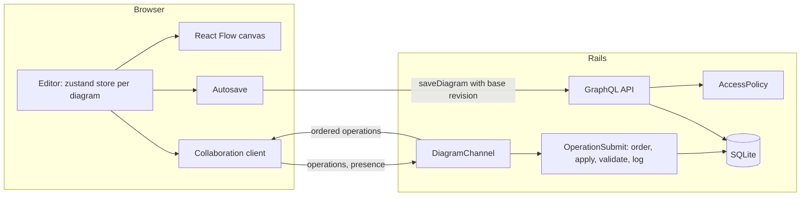

# Live Canvas

A real-time collaborative diagram editor for planning maker projects: a Rails GraphQL and Action Cable API with a React, TypeScript and React Flow client. Built to show how to keep several people's edits consistent without a CRDT, and a canvas that stays fast at thousands of nodes.

**Live demo:** TODO: add the URL after deploying (steps in [DEPLOY.md](DEPLOY.md)). Until then, `bin/dev` runs it locally in one command.

[](https://github.com/Nawfaldev19/realtime-reactflow-canvas/actions/workflows/ci.yml)
[](LICENSE)


*Ada (left) edits; Ben (right) sees her cursor live and each change as it is stored. Recorded by `npm run record:hero`; a full-size still is in [docs/screenshot.png](docs/screenshot.png).*

## Why it exists

Members of a fictional network of community makerspaces plan builds together: a walnut side table, a laser-cut lamp shade, a weather station. A plan is a diagram of steps, decisions and notes that two or three people edit at the same time. I built it to work through the hard parts of a collaborative canvas end to end: an edit protocol that never silently loses work, connector geometry that holds up when people reshape it by hand, and rendering that stays fast at a few thousand nodes.

## Key features

- **Edit together without losing work.** Changes appear for everyone as soon as the server stores them, with live cursors and "editing" badges. Copies always converge, the editor keeps working offline, and undo reverts only your own changes. [How it works](docs/features/collaboration.md)
- **Connectors that route themselves and keep your edits.** Orthogonal routes detour around the steps they connect, and segments you drag stay put when steps move. Splines and polylines pass through points you add, snapped in screen pixels. [Orthogonal routing](docs/features/orthogonal-routing.md) · [Route styles](docs/features/route-styles.md)
- **Alignment that feels the same at any zoom.** Guides come from a sorted index, so dragging stays smooth on large diagrams and the guide does not flicker between near-equal candidates. [Alignment guides](docs/features/alignment-guides.md)
- **Large diagrams stay responsive.** The editor opens a 2,000-node diagram in ~160 ms, because only nodes in view are mounted. A drag holds 60 fps and re-renders one node. [Performance](docs/features/performance.md)
- **Groups and lines that behave.** Nested groups support drag-in and Alt-drag-out and keep every reference through copy, restore and versions. Lines rotate any number of times without drifting. [Group nodes](docs/features/group-nodes.md) · [Line rotation](docs/features/line-rotation.md)
- **A preview that builds the plan up.** Steps fade in in reading order and connectors draw to targets that are always already there, with complete cancellation. [Reveal animation](docs/features/reveal-animation.md)

Also included: version history with visual compare and one-step restore, two auto-layout engines, PNG and paged PDF export, find, copy and paste, light and dark themes.

## Quick start

Requirements: Ruby 3.3 (exact version in [`server/.ruby-version`](server/.ruby-version)) and Node.js 20 or newer. No database server is needed.

```bash
git clone https://github.com/Nawfaldev19/realtime-reactflow-canvas.git
cd realtime-reactflow-canvas
bin/dev
```

`bin/dev` installs dependencies into the project folders, creates and seeds the SQLite database on first run, and starts the API on http://localhost:3000 and the web app on http://localhost:5173. Open the web app, click **Try the demo** and pick a person; there are no passwords.

To see collaboration, open "Build a walnut side table" as **Ada Okafor** (owner at Riverside Makers) in one window and as **Ben Lindqvist** (editor) in a private window. Move a step or drag a connector in one; the other follows. **Cora Mbeki** is a viewer and gets a read-only live view. Reset the data with `cd server && bin/rails db:seed`.

## Key decisions and trade-offs

The diagram shows where the pieces sit. The trade-offs that shaped it follow the diagram.



Every edit is an operation applied by one pure function on the client and by its Ruby port on the server. While collaborating, the server is the single writer: it orders each operation, validates the resulting document and broadcasts it in full. Clients keep a confirmed copy plus a queue of their own pending operations. More in [docs/ARCHITECTURE.md](docs/ARCHITECTURE.md).

- **A server-ordered log, not a CRDT.** The server must authorise and validate every change anyway, so it can also order them. Clients need no clocks or tombstones. The price is per-field merging: two people typing in the same note keep the later text.
- **The server mints session ids.** Re-sent changes are de-duplicated by member, session and change id, and a signed token resumes a session after a reconnect, so no client can acknowledge or suppress another's changes.
- **SQLite and one process.** The project runs with one command. The concurrency tests prove less on SQLite than they would on PostgreSQL, and scaling out needs a shared cable adapter.
- **Visible-only rendering.** Opening and panning no longer depend on diagram size, but each zoom-out tick mounts the nodes that come into view.

## Stack

| Choice | Why |
|---|---|
| Rails 8 API, graphql-ruby | Models, validations and transactions I trust; one typed endpoint with query limits and batched loading |
| Action Cable | Websockets in the same app, sharing its authentication and models |
| SQLite | Zero setup for anyone running the project |
| React 18, TypeScript (strict) | Strict null checks across a large interactive UI |
| React Flow (`@xyflow/react`) | Pan, zoom, selection and culling, under my own nodes, edges, routing and snapping |
| zustand | One store per open diagram, with selectors that keep re-renders narrow |
| Apollo Client, GraphQL Code Generator | A normalised cache and operations typed from the server's schema |
| dagre | A fast layout engine with a permissive licence; the second engine is my own (ELK's licence is not permissive) |
| html-to-image | Rasterising the canvas for export; the PDF writer is mine |
| Vitest, Testing Library, Minitest, Playwright | One fast runner per layer, and real browsers two at a time for collaboration |

## Testing and quality

| Suite | Result |
|---|---|
| Rails (`bin/rails test`) | 235 runs, 0 failures, 99% line coverage |
| Vitest (`npm run test:coverage`) | 1,282 tests, 98% line coverage, at least 90% enforced on every algorithm module |
| Playwright (`npm run test:e2e`) | 44 tests, including two browsers editing together and the production build under its content security policy |

Algorithms live in framework-free modules with hand-computed examples and property tests. The same 22 operation cases run against the TypeScript and Ruby appliers. CI runs RuboCop, ESLint (`strictTypeChecked`), Prettier, typecheck, all three suites, the build, `npm audit --omit=dev`, a gem advisory check and a licence audit. Details and known gaps: [docs/TESTING.md](docs/TESTING.md). Security model: [docs/SECURITY.md](docs/SECURITY.md).

```bash
cd server && bundle exec rubocop && bin/rails test
cd client && npm run lint && npm run typecheck && npm run test:coverage && npm run build
cd client && npm run test:e2e          # browsers in client/.pw-browsers: npx playwright install chromium
```

## Decisions

The ten decisions that shape the system are written up as ADRs, with every smaller choice in one table: [docs/DECISIONS.md](docs/DECISIONS.md). [docs/LESSONS.md](docs/LESSONS.md) covers what went wrong and what I would watch for next time.

## What I would do next

- **Zooming out over a very large diagram is slow.** About a quarter of zoom frames run over 25 ms at 500 to 2,000 nodes. Next step: a simplified drawing below a zoom threshold.
- **Per-field merging.** Simultaneous typing in one note keeps the later text, and peers see a drag when it ends, not while it happens.
- **Demo sign-in.** Anyone can continue as any seeded person. Tokens live in `localStorage` and expire after 12 hours without revocation.
- **One server process.** The cable adapter and rate limits are in memory.
- **Concurrency tested on SQLite only**, and end-to-end tests run in Chromium only.
- **Development tooling** (Vite 5, Vitest 2, the code generator, Playwright 1.49.1) has advisories that need major upgrades; the shipped bundle has none.
- **Not built:** rich text inside a node, media nodes, comments, publishing and embedding, a single-editor lock, a per-edit history scrubber.

## Project status

A portfolio project, feature-complete for what it sets out to show and maintained. It is not deployed yet; run it locally with `bin/dev`. A free Render setup is ready in [DEPLOY.md](DEPLOY.md). Changes are listed in [CHANGELOG.md](CHANGELOG.md).

## Author

Nawfal Imran · [GitHub](https://github.com/Nawfaldev19) · [LinkedIn](https://www.linkedin.com/in/nawfal-imran-886b13218)

## License and credits

[MIT](LICENSE). Connector geometry adapts or re-implements parts of React Flow's MIT-licensed edges and examples, credited in [docs/REFERENCES.md](docs/REFERENCES.md#react-flow-mit-xyflow) and at the top of each adapted module. Fonts (Fraunces, Inter, JetBrains Mono) are under the SIL Open Font License and icons are Lucide (ISC); every dependency is listed in [THIRD_PARTY_NOTICES.md](THIRD_PARTY_NOTICES.md).
