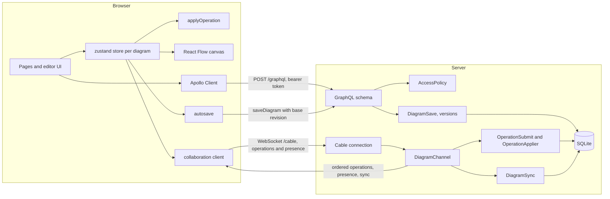

# Architecture

A Rails 8 GraphQL API with an Action Cable room per diagram, and a React client built around React Flow and one zustand store per open diagram. The reasons behind the big choices are in [DECISIONS.md](DECISIONS.md); each headline feature has its own page under [features/](features/).



- **One change pipeline.** Every edit, local or remote, is an operation applied by the same pure function on the client and by its Ruby port on the server ([ADR-001](DECISIONS.md#adr-001-a-server-ordered-operation-log-instead-of-a-crdt)).
- **Two ways to persist.** While collaborating (the default) the server orders, applies and stores each operation. With collaboration off, autosave sends whole documents with a revision check and rebases on a conflict.
- **Authorization in one place.** The API and the socket authenticate with the same signed token and reach records only through `AccessPolicy`.

## Folder map

```
bin/dev                one-command start: installs, prepares the database, runs both apps
scripts/               licence audit and gem advisory check (Node), with tests
server/                Rails 8 API (Ruby 3.3)
  app/channels/        socket authentication and the diagram room
  app/graphql/         schema, types, mutations, batched loader
  app/models/          workspaces, members, memberships, diagrams, versions, operation log
  app/services/        access policy, tokens, throttle, validation, saving, ordering, sync, versions
client/                Vite, React 18, TypeScript (strict)
  src/document/        document model, operations, undo history, clipboard, search
  src/geometry/        vectors, paths, outlines, lines, guides, freehand
  src/routing/         connector routing and editing
  src/layout/          dagre adapter and the layered engine
  src/viewport/        view maths: fit, zoom, pan bounds, scrollbars
  src/reveal/          reveal order, timeline, controller
  src/collab/          protocol, sequencer, state machine, reconciliation, presence
  src/versions/        diff, overlay, restore, cadence
  src/export/          pagination, PDF writer, capture
  src/perf/, stress/   performance switches, counters, the stress diagram generator
  src/editor/          store slices, canvas, nodes, edges, panels, menus
  e2e/, scripts/       Playwright tests; benchmark, screenshot and hero recording
```

The folders down to `src/export/` (apart from capture) are framework-free: no React, no DOM, unit-tested to at least 90% each.

## The document

A diagram is one JSON document, validated on the server on every save and after every operation.

| Field | Meaning |
|---|---|
| `schemaVersion`, `nextNumber` | Format version; the next short node number (never reused) |
| `nodes[]` | `id` and stable `key`, `kind`, `number`, `position` (relative to `parentId` when set), `size`, `z`, `style` (one field), `data` (merged per key) |
| `edges[]` | `id`, `key`, `kind` (`connector` or `floating`), `source`, `target`, sides (`null` = automatic), `route { style, points[] }`, `label`, `style` |
| `layout` | Present only while an automatic layout is active: engine, direction and the manual arrangement it replaced |

Node kinds: `step`, `decision`, `start-end`, `note`, `label`, `shape`, `line`, `sketch`, `group`. Route styles: `step` (orthogonal), `polyline`, `spline`, `bezier`. View settings (opening view, background, the reveal switch, snapping) live in their own column. Selection, drag positions, measured sizes and editing state are never stored.

## How an edit flows

1. A gesture produces canvas change events, or a node body handles it directly (rotation, text editing, drawing).
2. `canvasChanges.ts` turns them into store actions. Drag, resize and rotation frames are ephemeral; the end of the gesture commits one operation.
3. `store.apply(op)` runs `applyOperation`. If the document changed, the operation joins the pending queue and the person's undo history.
4. The flow adapter maps the document to React Flow objects, reusing every unchanged one, so only what changed re-renders.
5. While collaborating, the session submits the operation; the server orders, stores and broadcasts it, and the echo removes it from the queue. Remote operations are applied to the confirmed copy and the queue is replayed on top.
6. With collaboration off, autosave sends the document 2 s after the last change (at most 10 s apart) with its base revision.

## The layers

| Area | In short | More |
|---|---|---|
| Server | Access policy, document validation, revision-checked saves, operation ordering, versions | [SECURITY.md](SECURITY.md) |
| Nodes | One shell around a body per kind; shapes wrap text inside their outline | [groups](features/group-nodes.md), [lines](features/line-rotation.md) |
| Connectors | Pure routing behind `computeRoute`; one operation per drag | [orthogonal](features/orthogonal-routing.md), [styles](features/route-styles.md) |
| Editor tools | Guides, align and distribute, two layout engines, per-person undo, clipboard, find | [guides](features/alignment-guides.md) |
| Viewing | Opening view applied once, pan or scroll navigation, preview, export | [reveal](features/reveal-animation.md) |
| Collaboration | Server-ordered operations, confirmed copy plus pending queue, presence | [collaboration](features/collaboration.md) |
| History | Snapshots, key-matched compare, restore as one operation | [ADR-005](DECISIONS.md#adr-005-versions-are-snapshots-compared-and-restored-by-stable-key) |
| Performance | Visible-only rendering, frame and body split, guards | [performance](features/performance.md) |
