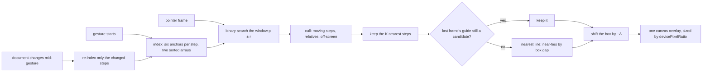

# Alignment guides

## What it does

While a step is dragged or resized, its edges and centre snap to the same features of nearby steps, and a guide line shows where. Snapping engages at the same on-screen distance at every zoom, the guide does not flicker between nearly equal candidates, and it stays smooth on large diagrams and while collaborators move steps mid-drag.

Code: `client/src/geometry/guides.ts` (index and snap maths), `client/src/editor/snapping.ts` (one index per gesture), `canvasChanges.ts` (snapping applied before the store), `guideDrawing.ts` and `GuideOverlay.tsx`. Decision: [ADR-007](../DECISIONS.md#adr-007-alignment-guides-from-a-sorted-incrementally-updated-index).

## How it works

- **Six anchors per step.** Top, middle and bottom are y values (horizontal guides); left, centre and right are x values (vertical guides). Each orientation is one array sorted by value. A lookup is O(log n + k) per anchor and frame.
- **Built once per gesture, updated incrementally.** When a collaborator's move or an undo lands mid-gesture, only the steps whose objects changed are removed and re-inserted.
- **Applied before the store.** Drag and resize frames are rewritten in `canvasChanges.ts`, so snapping costs no extra render; only the two active guides are reactive.

**Radius in screen pixels.** r = 8 / zoom canvas units.

**Viewport culling.** With the viewport transform (x, y, zoom) and element size W × H, the visible area is (−x / zoom, −y / zoom, W / zoom, H / zoom). Only steps overlapping it are candidates.

**Nearest K.** Candidates are grouped by step, ranked by the gap between that step's box and the moving box, and only the K nearest remain (K = 2, adjustable 1 to 10).

**Choice and hysteresis.** The previous frame's guide wins while it is still a candidate. Otherwise the nearest line wins, but lines within 0.5 units of each other are ordered by box gap, so the visibly closer step wins a near-tie.

**Snap.** For the matched anchor, Δ = anchor − guide; when |Δ| ≤ r the box moves by −Δ on that axis. Resizing snaps only the moving edges and never below the step's minimum size.

## Edge cases

| Case | What happens |
|---|---|
| The dragged step's group, children or ancestors | Excluded; steps inside other groups snap by their absolute boxes. |
| A multi-selection | Its bounding box snaps. |
| "Snap only to this step" | Only that step's guides count; the reference clears itself when the step is removed. |
| Keyboard nudges | Never snap. |
| Ratio-locked resize | Not snapped, because a snapped edge would break the ratio. |
| A third aligned step farther away | No guide with K = 2. |
| Snapping off | No index, no guides; the setting is saved with the diagram's view settings. |

## Tests

- `geometry/guides.test.ts`: hand-computed anchors; the incremental index equals a rebuild (property test); viewport conversion and culling; nearest K; the 0.5 tie rule; no switch while the pointer moves steadily across two guides 0.3 apart; the same behaviour at zoom 0.5, 1 and 2; resize snapping and the minimum size.
- `editor/snapping.test.ts`: group exclusions and re-indexing mid-gesture.
- `editor/guideDrawing.test.ts`: pixel-ratio scaling, solid and dashed lines, colours.
- `client/e2e/editor-tools.spec.ts`: guides appear and snap while dragging and resizing, read from data attributes on the overlay.

## Limits

- Guides align edges and centres only; there are no equal-spacing guides.
- Only steps in the viewport are candidates, so a step just off screen never snaps.

The index and its rules are my own; the overlay follows MDN's guidance on scaling a canvas for `devicePixelRatio`.
