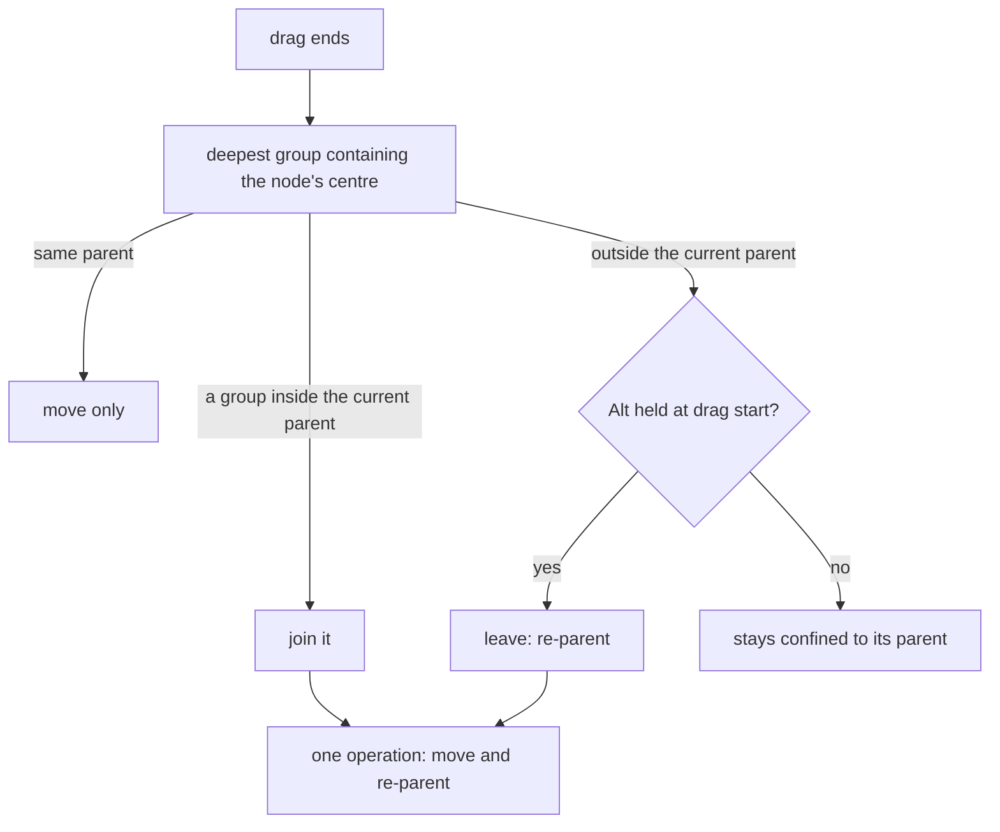

# Group nodes

## What it does

A group is a framed area with a title that holds other nodes, for example the "Glue-up" stage of the walnut side table. Children move with their group, can be dragged in, and with Alt dragged out. Connectors can attach to the group itself. Groups nest, and they survive saving, copy and paste, versions, restore and collaboration with every reference intact.

Code: `client/src/document/groups.ts` (coordinates, grouping, drop targets), `operations.ts` (parent checks and cascades), `serialize.ts` (parents-first order and repair), `client/src/editor/flowAdapter.ts` (stacking and confinement), `editor/nodes/GroupNode.tsx`; on the server `diagram_document.rb` and `version_copy.rb`.

## How it works



- **Relative positions, derived absolute ones.** A child's stored position is relative to its group, as React Flow expects; snapping, alignment, the properties panel, presence badges and export use absolute positions, derived by adding every ancestor's position.
- **Every group action is an operation**, so it is saved, sent to collaborators and undone like any edit. A move plus a re-parent is one operation.
- **Confinement, Alt to leave.** Children carry React Flow's `extent: "parent"`. Holding Alt when a drag starts lets them leave. Joining a group nested inside the current parent needs no modifier.
- **Two stacking bands.** Groups get negative z-indices by nesting depth, below the connector layer at 0; every other node keeps its own order above it. A group's background is under the connectors and its children are above them.
- **Parents first on disk.** Saved documents list parents before children. Loading repairs stale references through stable keys and moves what cannot be resolved to the top level, never guessing a parent. The server checks that every parent exists, is a group and forms no cycle.

**Coordinates.** For node n with ancestors g₁ … g_k:

```
abs(n) = pos(n) + pos(g₁) + … + pos(g_k)
re-parent to g without moving on screen:  pos'(n) = abs(n) − abs(g)
```

**Grouping** wraps the selection's absolute bounds with 25 units of padding; **ungrouping** releases children into the group's parent at the same on-screen positions and removes the group.

## Edge cases

| Case | What happens |
|---|---|
| Grouping nodes from different parents | Refused, with the reason on the Group button. |
| Grouping inside an existing group | Allowed; the new group nests without moving anything. |
| A group that would contain itself | Refused by `applyOperation` and by the server. |
| A connector from a group to its own child | Refused. Connectors to and from groups are allowed. |
| Deleting a group | Deletes its children and their connectors in one undoable operation. |
| An empty group | Offers Delete instead of Ungroup. |
| A child whose parent cannot be found on load | Moved to the top level at its absolute position, and reported. |
| Copy and paste, restore, version copy | Children come along with new ids and are re-parented through an id map. |

## Tests

- `document/groups.test.ts`: absolute boxes; re-parenting keeps the on-screen position; group, move the group 100 units, ungroup, and every child ends exactly 100 units over; nested groups survive save and reload; drop targets; Alt rules.
- `document/serialize.test.ts`: parents before children at any depth; stale parents re-attached through keys; unresolvable children detached; cycles broken.
- `editor/nodes/GroupNode.test.tsx`: background below connectors, children above; join on release; leave only with Alt.
- `document/clipboard.test.ts`, `versions/restore.test.ts`, and on the server `diagram_document_test.rb` and `version_copy_test.rb`.
- `client/e2e/group.spec.ts`: grouping, dragging a node in and Alt-dragging it out.

## Limits

- Alt must be held when the drag starts, because React Flow captures the extent then.
- Groups do not grow to fit their children automatically; a child stays confined to the current frame.
- A node stacked above a selected node can cover its resize handles until the selected node is brought forward.

The relative-position model, `extent: "parent"` and parents-first ordering come from React Flow's sub-flow guide (MIT); drag in and out, the stacking bands and reference repair are mine.
