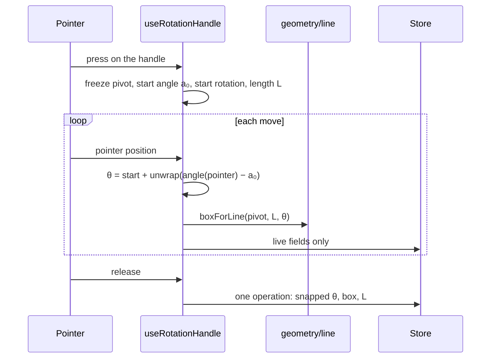

# Line node rotation

## What it does

A line node is a straight stroke inside a box. People rotate it with a round handle beside its midpoint, with ±5° buttons, a slider or a number field. Near 0°, 90°, 180° and 270° a dashed guide previews the snap, and releasing there snaps exactly. However often a line is rotated, its pivot stays put and its length does not change.

Code: `client/src/geometry/line.ts` (slab clipping, the derived box), `geometry/angles.ts` (normalize, unwrap, snap), `client/src/document/lines.ts` (the one rule every control uses), `client/src/editor/nodes/useRotationHandle.ts` and `LineNode.tsx`.

## How it works



- **Store the angle and the length; derive the box.** `data.rotation` (degrees in [0, 360), 0° up, 90° right) and `data.length` are stored. Reading the length back from the box after each rotation is what makes lines drift.
- **Freeze at press.** Pivot, start angle and length are captured once; each move is computed from them, never from the previous frame.
- **One rule for every control.** Buttons, slider, number field and snap commands all go through `lineRotationFields`.
- **Ink-only hit area.** Only the stroke (with a 12-pixel invisible hit stroke) and the handle take the pointer, so a diagonal line's empty box never steals a click.

**Direction**, with y growing downwards: d(θ) = (sin θ, −cos θ).

**Unwrapping** the turn into (−180°, 180°] avoids a full spin at the 0°/360° seam: Δ = normalize(a − a₀), minus 360 when above 180.

**Derived box** around the pivot c:

```
w = max(L·|sin θ|, 20)      h = max(L·|cos θ|, 20)
box = (c.x − w/2, c.y − h/2, w, h)
```

**Drawing.** The stroke runs through the box centre along d(θ), clipped to the box with slab clipping. L is kept within [30, 2500]; since 30 > 20·√2, at most one side is ever clamped to 20, so clipping returns exactly L.

**Snap.** The nearest cardinal angle is taken when the circular distance is at most 7°: releasing at 86° gives 90°, and 82° stays 82°.

## Edge cases

| Case | What happens |
|---|---|
| 360 successive +1° rotations | Same box within floating-point error. |
| Rotating across 0°/360° | Unwrapped; no full turn. |
| Resizing a line | Keeps the angle; the new length is the clipped length of the new box, at least 30. |
| "Snap horizontal" from exactly vertical | 90°, the first of two equal candidates. |
| Deselecting mid-drag or a cancelled pointer | Live fields dropped; the line is unchanged. |
| A line inside a group | The pivot is absolute; the stored position is converted back to the parent's coordinates. |

## Tests

- `geometry/line.test.ts`: the direction convention; slab exits; clipping gives back exactly the stored length; 360 successive +1° rotations keep length and pivot; resize uses the clipped length.
- `geometry/angles.test.ts`: normalize never returns −0 or 360; 86° snaps, 82° does not; the 7° boundary wraps around 0°.
- `document/lines.test.ts`: buttons, snapping and the slider give the same box for the same angle.
- `editor/nodes/LineNode.test.tsx`: preview and snap on release in one operation; unwrapping; deselecting cancels.
- `client/e2e/line.spec.ts`: rotating with the handle previews and snaps in a real browser.

## Limits

- Lines are straight, single-segment strokes; bent or multi-point lines are connectors' job.
- Release snapping is to the four cardinal angles only, not to 45° steps or to other lines.
