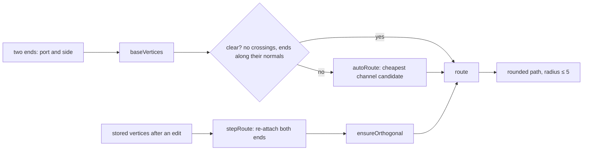

# Orthogonal routing and editable segments

## What it does

Connectors in the "Orthogonal step" style draw only horizontal and vertical segments with rounded corners. They find their own route, including a detour when the simple elbow would run back through a step. Once someone drags a segment, that route is kept, and its two ends re-attach whenever a step moves, without ever producing a diagonal.

Code: `client/src/routing/orthogonal.ts` (automatic routes), `stepEdit.ts` (editing and re-attachment), `route.ts` (`computeRoute`, the single entry point), `client/src/editor/edges/RouteHandles.tsx`. Decision: [ADR-006](../DECISIONS.md#adr-006-my-own-orthogonal-router).

## How it works



1. **Base route.** Each port gets a 20-unit stub along its side's normal. Opposite sides get a middle leg through the midpoint of the ports; other pairs get one corner, flipped when the default corner would double back. This matches React Flow's smooth-step edge.
2. **Judge by what is visible.** Duplicate points and back-and-forth spikes are removed, then a route is clear when no segment crosses a step other than along its own stub.
3. **Detour only when blocked.** Candidates with up to three corners take their coordinates from a short list of channels: the stub ends, their midpoint, 20 units outside each box, and the middle of the gap between the boxes. About 70 candidates are scored

   ```
   cost = 10⁶ · crossings + 10⁵ · wrong-way ends + 30 · bends + length
   ```

   so a clear route always wins, then fewer bends, then the shorter one.
4. **Edits are stored stub to stub.** After a drag, `route.points` holds every vertex from the source stub to the target stub, each with an id, the axis its segment moves along and a `userCreated` flag.
5. **Re-attach on every render.** `stepRoute` moves the stored ends to the current ports. If an end would now turn back or cut through its step (which is how a changed side shows up), that end is re-routed to the nearest kept vertex. A final pass inserts an elbow into any diagonal.

**Rounded corners.** For consecutive vertices A, B, C the corner at B uses r = min(|AB| / 2, |BC| / 2, 5), so two corners on a short segment meet in the middle and never overlap.

**Segment drag.** A segment between vertices i and i + 1 that moves along axis a takes the pointer's coordinate on that axis. When it starts or ends at a stub, the stub is copied once per drag, so the port stays put and the copy becomes the new bend.

## Edge cases

| Case | What happens |
|---|---|
| Ports aligned and facing | A straight line. |
| Two steps closer than two stubs, ports aligned | A straight line rather than a detour around both. |
| Target behind the source | The detour goes around both boxes. |
| A step moves so a stored route would leave the wrong way | That end is re-routed from its stub to the nearest kept vertex. |
| Delete on a segment handle | The segment moves onto its neighbour; the connector returns to automatic routing when that is no more complex. |
| A press without movement | Nothing is stored. |
| Space held while connecting | The sketched points snap to right angles and become the stored vertices. |
| Keyboard | Segment handles are focusable; arrows nudge along the segment's axis. |

## Tests

- `routing/orthogonal.test.ts`: base routes against hand-computed vertices; equality with the library's smooth-step output for 16 side pairs × 12 targets (192 paths); orthogonality and no corner overlap (property tests); detours never enter either box except along a stub, over more than 200 random layouts.
- `routing/stepEdit.test.ts`: a middle segment moves on one axis; dragging the first segment inserts exactly one bend; removing the only edit returns to the automatic route; a property test applies random drags and step moves (25 per run, 60 runs) and checks the route stays orthogonal and attached.
- `client/e2e/connectors.spec.ts`: dragging a segment inserts one bend at the stub, and the edited route follows a moved step.

## Limits

- Detours consider only the two connected steps, not every step on the canvas, so a route can still cross a third step.
- Edited routes are kept as drawn; there is no "tidy up" that simplifies them automatically.

The base point generation and corner rounding re-implement React Flow's smooth-step edge (MIT) from a written description; the detour search, editing and re-attachment are mine. See [REFERENCES.md](../REFERENCES.md).
