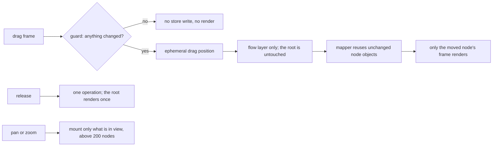

# Performance on large diagrams

## What it does

The editor stays responsive on generated diagrams of 500, 1,000 and 2,000 nodes. It opens a 2,000-node diagram in about 160 ms, because only the nodes in view are mounted (25 to 30 at 100% zoom). A drag at that size holds 60 frames a second and re-renders only the dragged node. Zooming out over a large diagram is still slow; see Limits.

Decision: [ADR-004](../DECISIONS.md#adr-004-visible-only-rendering-with-every-performance-technique-switchable).

## How it works

Six techniques, each with a query flag that turns it off so its effect can be measured:

| Flag | Technique | Where |
|---|---|---|
| `no-visible` | Mount only what is in the viewport above 200 nodes; never-mounted nodes get static side handles so connectors to them still draw; export mounts everything | `editor/Canvas.tsx`, `editor/flowAdapter.ts` |
| `no-guards` | Setters and mappers keep the same reference when an update changes nothing | `perf/guards.ts`, `editor/flowAdapter.ts` |
| `no-stable` | Every handler passed to React Flow has one identity and calls the latest closure | `perf/useStableCallback.ts` |
| `no-batch` | Drag frames are ephemeral; the release commits one operation | `editor/canvasChanges.ts` |
| `no-shallow` | Object selectors compare entries, not references | `editor/EditorStoreContext.tsx` |
| `no-memo` | Each node kind is a thin frame around a memoized body | `editor/nodes/nodeFrame.tsx` |

The canvas root (chrome, menus, footer) and the flow layer are separate components, so per-frame state never reaches the root.

## Measurements

`npm run bench` builds for production, serves it with `vite preview`, opens `/stress?stress&size=N` (a deterministic grid with groups, connectors and labels) and, for each size and configuration, drags a step for 90 pointer moves, pans for 90 moves and zooms 18 ticks out and back. It records frame intervals with `requestAnimationFrame`, the time from each input event to the next task, and exact render counts. Every value is the median of 3 runs after a warm-up. Machine: Intel Core i7-9750H, 32 GB, macOS 13, headless Chromium 131 at 1440 × 900. Full tables: [benchmark-results.md](../benchmarks/benchmark-results.md).

2,000 nodes, all techniques on, and each one off (ms; renders per drag are root / node frames / node bodies):

| Configuration | Open | Drag frame p95 | Drag handling median / p95 | Pan frame p95 | Zoom frame p95 | Renders per drag | Operations per drag |
|---|---|---|---|---|---|---|---|
| **all on** | **160.6** | **16.8** | **6.5 / 10.0** | **16.8** | **99.9** | **1 / 57 / 2** | **1** |
| no-visible | 2,195.6 | 99.9 | 92.4 / 124.4 | 116.7 | 433.3 | 1 / 57 / 2 | 1 |
| no-guards | 165.3 | 16.8 | 13.4 / 18.1 | 16.7 | 83.4 | 1 / 2,277 / 2 | 1 |
| no-stable | 186.4 | 16.7 | 10.9 / 13.3 | 16.8 | 116.6 | 1 / 1,431 / 2 | 1 |
| no-batch | 148.3 | 16.8 | 14.0 / 17.3 | 16.8 | 83.3 | 89 / 92 / 90 | 89 |
| no-shallow | 151.2 | 16.8 | 6.9 / 9.6 | 16.8 | 83.3 | 55 / 57 / 2 | 1 |
| no-memo | 149.5 | 16.8 | 6.7 / 9.0 | 16.8 | 83.3 | 1 / 57 / 57 | 1 |

Visible-only rendering is the big win (open 2.2 s to 160 ms, drag handling 92 to 6.5 ms). Guards and stable callbacks stop every mounted node re-rendering on every frame; batching turns 89 operations into one. Shallow selectors and memoized bodies show in render counts rather than times on a one-node drag.

Frame intervals are quantised to the 60 Hz refresh, so 16.7 ms means no dropped frame, not 16.7 ms of work. This is one laptop in headless Chromium: compare rows with each other, not with your machine.

## Edge cases

| Case | What happens |
|---|---|
| A connector from a visible step to one never mounted | Drawn to the off-screen step's static side-centre handles. |
| Export | Mounts every node for the capture, then returns to culling. |
| Find, layout, guides, version compare | Read the document, never the DOM, so unmounted nodes count. |
| Diagrams under 200 nodes | Everything stays mounted; culling would cost more than it saves. |

## Tests

- `client/src/editor/performance.test.tsx`: a 10-frame drag of one of 24 steps renders only that node's frame, and the release renders the root once and commits one operation; with `batch: false` every frame is an operation; selector stability; guards; a 220-node diagram mounts the 25 nodes in view and all 220 while exporting.
- `client/src/perf/*.test.ts`: flags, guards, render counters, statistics, `useStableCallback`.
- `client/e2e/stress.spec.ts`: a drag on the 500-node page commits one operation and renders only that node; visible-only rendering can be switched off.

## Limits

- **Zooming out is slow.** Each tick mounts the nodes that come into view, so about a quarter of zoom frames run over 25 ms at every size (p95 83 to 100 ms). A simplified drawing below a zoom threshold, or mounting in idle time, would be the next step; neither is built.
- The benchmark takes about 9 minutes and is not in CI. The render-count tests are what catch regressions.
