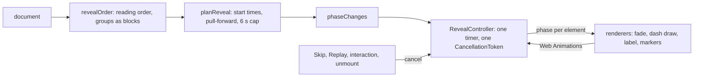

# The build-up reveal animation

## What it does

In the preview, a diagram can build itself up: steps fade in in reading order, and each connector draws itself from source to target, with its label and arrowhead after the line. Skip shows the final state, Replay starts again, any pan, zoom or click finishes it, and people who prefer reduced motion see the final state at once. "Build a walnut side table" has it switched on in the seed data.

Code: `client/src/reveal/order.ts`, `timeline.ts`, `controller.ts` and `cancellation.ts`; the renderers' side in `client/src/preview/reveal.tsx` and `useReveal.ts`. Decision: [ADR-010](../DECISIONS.md#adr-010-the-reveal-animation-a-pure-planner-and-one-cancellable-controller).

## How it works

1. **Order.** Roots are nodes that start a connector and have none coming in (a pure cycle starts at its top-most node). A breadth-first walk visits successors in reading order (y, then x, then id), each node followed by its outgoing connectors. A group is revealed as a block: the group, its contents by absolute position, then its connectors. Unconnected notes follow in reading order.
2. **Timeline.** Pure numbers: start times, durations and a time-ordered list of phase changes.
3. **Controller.** Runs one timeline behind a `CancellationToken`. Only the next phase change is ever scheduled; renderers hand their Web Animations to it, so cancelling stops the timer and every animation. It publishes a phase per element and never touches the DOM.

The preview plays once, after the opening view is applied, in a layout effect, so the first visible frame already has the steps hidden. A refetch updates the drawing without replaying.

**Schedule.** Item i starts at 100 ms × i. A step fades in over 250 ms; a connector draws over 400 ms, its label fades in from +200 ms and its arrowhead appears at +400 ms. A target is pulled forward to start no later than the connector's end minus 250 ms, so it is fully visible when the line arrives, and a group starts no later than anything inside it. For n items the stagger shrinks to keep the whole animation under 6 s.

**Drawing from the source.** With L the path's `getTotalLength()`, the dash pattern animates from "L L" to "2L 2L" with the offset fixed at L. The visible part of the first dash grows from 0 to L, starting at the source end. Nothing is kept afterwards, so a dashed connector gets its own pattern back.

## Edge cases

| Case | What happens |
|---|---|
| Cycles | The visited set ends the walk; the loop-back connector draws to a visible step. |
| A connector with a missing end, or a zero-length path | Skipped. |
| Late timers on a busy main thread | Every change that is due is applied at once. |
| React's development double mount | Stopping is not final; the effect restarts cleanly. |
| Reduced motion | Nothing plays and Replay is disabled. |
| Export during the animation | Skips first, so the image shows everything. |
| Fit while steps are hidden | Bounds come from stored boxes, not the DOM. |

## Tests

- `reveal/order.test.ts`: chains, branches in reading order, cycles, groups as blocks, absolute positions, unreachable parts, and a property test that every node and valid connector appears once, after its source.
- `reveal/timeline.test.ts`: worked start times and durations, pull-forward, groups, the 6 s cap.
- `reveal/controller.test.ts` and `cancellation.test.ts`, with a manual clock: phases at the planned times, at most one pending timer and none when done, everything cancelled on Skip, Replay and stop.
- `preview/reveal.test.tsx` and `pages/PreviewPage.test.tsx`: dash keyframes against the measured length, the hidden first frame, refetch without replay, reduced motion.
- `client/e2e/reveal.spec.ts`: every phase change recorded in a real browser.

## Limits

- The reveal runs in the preview only, not in the editor.
- Timings are fixed; there is no per-diagram speed setting.
