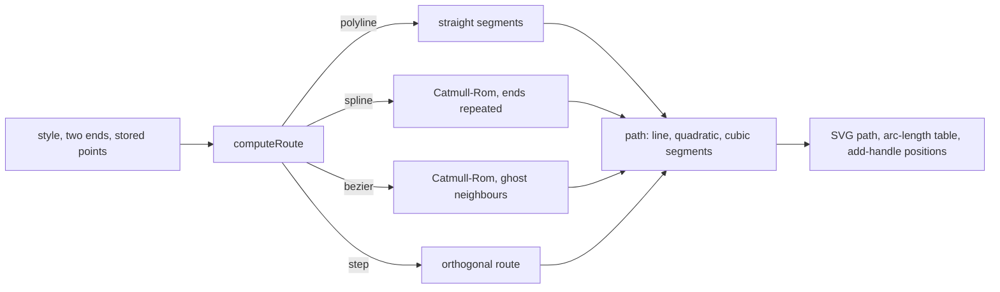

# Connector route styles and control points

## What it does

Every editable connector has one of four route styles: polyline, Catmull-Rom spline, a Bézier-flavoured spline, and orthogonal step ([its own page](orthogonal-routing.md)). The three free styles pass through control points that people add, drag, nudge with the keyboard and delete. Points snap to the connector's end anchors at the same on-screen distance at any zoom, and a drag is one undo step.

Code: `client/src/routing/route.ts` (`computeRoute`), `spline.ts`, `pointEdit.ts`, `sketch.ts`, `client/src/geometry/path.ts`, `client/src/editor/edges/RouteHandles.tsx` and `useHandleDrag.ts`.

## How it works



- **One geometry model.** A path is a list of line, quadratic and cubic segments with SVG output, a 48-chord arc-length table per curve, point-at-length and projection. The connector, the connection preview and label placement all use it, so the preview is the final path.
- **Points are data with ids** (`{ id, x, y, userCreated }`). The "add point" handle in the middle of each piece already carries the id the new point will get (an FNV-1a hash of its neighbours' ids), so the element under the pointer becomes the point without remounting and keeps its pointer capture.
- **Drafts, then one commit.** While a point moves, the connector redraws from a local draft at most once per animation frame; release, cancel or lost capture commits one `edge.update`.
- **Switching style** clears hand-placed points (they mean different things per style) and offers Undo.

**Catmull-Rom as exact cubic Béziers.** A uniform Catmull-Rom segment from A to B, with neighbours Z and Y, has end tangents (B − Z) / 2 and (Y − A) / 2. Matching them to a cubic Bézier gives

```
P0 = A,   P1 = A + (B − Z) / 6,   P2 = B − (Y − A) / 6,   P3 = B
```

which is the same polynomial, not an approximation. A plain spline repeats the end point as the missing neighbour.

**Bézier-flavoured ends.** React Flow's standard curve puts each control point on the port's outward normal n at an offset of 0.5·δ when δ ≥ 0 and 0.25 · 25 · √(−δ) otherwise, where δ is the distance to the other end along n. I choose a ghost neighbour Z = B + 6 · (A − K) so that the first control point equals that point K. The curve then leaves perpendicular to the port, passes through every point, and with no points is exactly the standard curve.

**Snapping in screen pixels.** A dragged point snaps to the x and the y of the two end anchors separately when the signed difference is within 7 / zoom canvas units; the nearest anchor per axis wins and a dashed guide shows each snap.

**Add-handle positions.** For splines, the point at parameter ½ of each piece, (−Z + 9A + 9B − Y) / 16, which lies exactly on the drawn curve.

## Edge cases

| Case | What happens |
|---|---|
| No points | Polyline is a straight line; the Bézier style is the library's standard curve. |
| Two consecutive points at the same place | That zero-length piece is skipped; both still shape their neighbours. |
| A second pointer during a drag | Ignored. |
| 200 points on one connector | The client stops adding; the server refuses more. |
| Space held while connecting | Points recorded every 25 units (50 for splines) become the connector's points. |
| Keyboard | Arrows move a focused point 5 units (1 with Alt); Delete removes it and focuses the previous one, never deleting the connector. |

## Tests

- `routing/spline.test.ts`: divide-by-six control points against hand-computed values; the curve passes through every point with continuous tangents; the ghost neighbours reproduce the library's curve within 0.01 units for every side pair; add handles lie within 0.5 units of the curve (property test).
- `routing/pointEdit.test.ts`: insert, move and remove with ids; x = 104 snaps to 100 at zoom 1, and at zoom 0.5 x = 112 snaps but 115 does not.
- `geometry/path.test.ts`: arc length, point at length, projection never worse than dense sampling.
- `editor/edges/ConnectorEdge.test.tsx`: a 40-move drag of a new point adds exactly one pending operation.
- `client/e2e/connectors.spec.ts`: style switching with undo, add handle to dragged point with snapping, sketched routes.

## Limits

- Snapping targets only the connector's own two anchors, not other connectors' points.
- Curves are measured with 48 chords per segment, well below a pixel of error at connector sizes but not exact.

The control-point rule for the standard curve follows React Flow's Bézier edge (MIT) and is checked against it in the tests. Catmull-Rom: E. Catmull and R. Rom (1974). See [REFERENCES.md](../REFERENCES.md).
